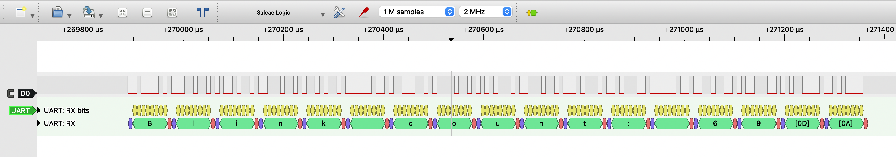
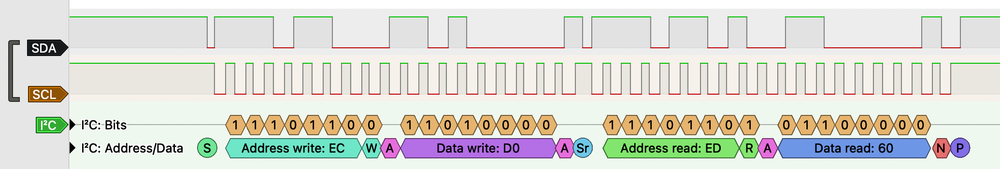
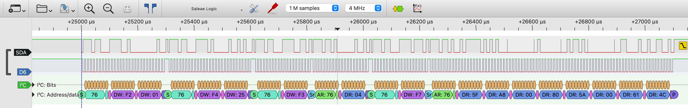
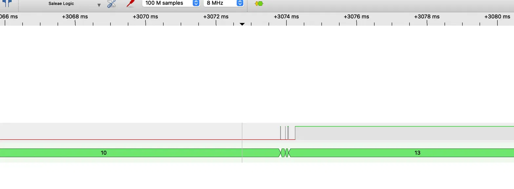
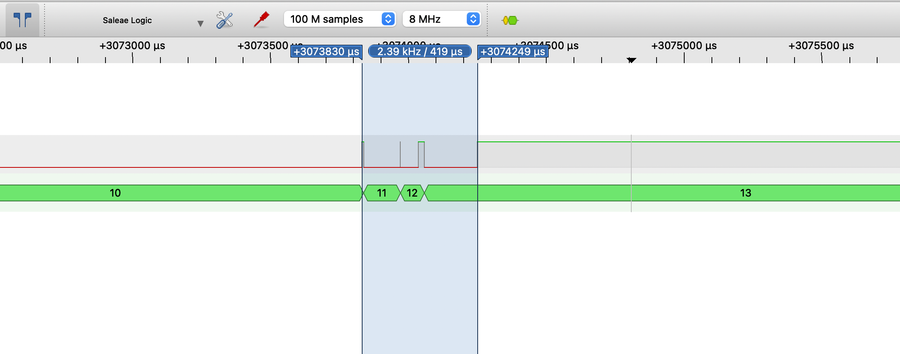
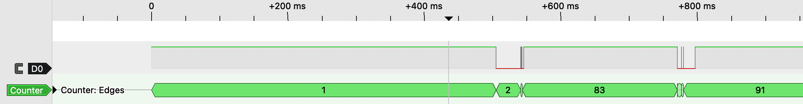
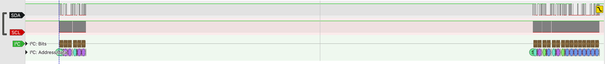

# Pico BME280 Test System
**Status:** UART output, button interrupt with debouncing and the BME280 driver are done and tested. Python tests in progress.

I wrote this project to get practical experience with C on a microcontroller and with bus protocols
I had only seen in lectures. A Pico 2 WH reads a BME280 sensor over I2C using my own driver and prints the values over USB/UART.
A Python test system checks the data using pyserial and pytest.
I broke the setup on purpose to see if the test system could detect the faults.
I also used a logic analyzer to capture the bus traffic, including the faults and verify that the driver behaves as expected.

## Hardware
| Component | Notes |
|---|---|
| Raspberry Pi Pico 2 WH | RP2350 (Cortex-M33), 3.3 V logic |
| BME280 breakout | I2C, pins labeled VCC/GND/SDA/SCK/ADDR/CS |
| Logic analyzer | 8 ch, 24 MHz, PulseView/sigrok |
| Push button, LED, 330 Ω | user input and feedback |

## Wiring
| Pico | Connected to | Analyzer |
|---|---|---|
| GPIO 0 (pin 1) | UART TX | D0 |
| GPIO 14 (pin 19) | LED → 330 Ω → GND | – |
| GPIO 15 (pin 20) | push button → GND (internal pull-up) | D0 (during button tests) |
| GND (pin 3 / 18) | common ground | GND |
| GPIO 4 (pin 6) | BME280 SDA (I2C0) | D0 (during I2C captures) |
| GPIO 5 (pin 7) | BME280 SCK = SCL (I2C0) | D6 (not D1, see crosstalk) |
| 3V3 OUT (pin 36) | BME280 VCC and CS (CS high selects I2C) | – |
| GND (pin 38) | BME280 GND and ADDR (ADDR low → address 0x76) | – |

## Architecture
BME280 → I2C (100 kHz) → Pico → USB/UART → Python test → report

The driver (`bme280.c/.h`) does not know the pins. 
It gets an I2C instance and an address in a handle (`bme280_t`). 
The board setup (pins, `i2c_init`) stays in `c_pico.c`.

## Build and Flash
| Tool | Version |
|---|---|
| Pico SDK | 2.3.1 |
| ARM GCC | 13.2.Rel1 |
| CMake | 4.3.4 |
| Ninja | 1.13.2 |

Target board: `pico2_w`

1. Open the `firmware/` folder in VS Code with the Raspberry Pi Pico extension installed. On first open the extension downloads the SDK and toolchain.
2. Click **Compile** in the status bar. The output ends up in `firmware/build/`, e.g. `c_pico.uf2`.
3. Hold BOOTSEL, plug in USB, and copy the `.uf2` to the `RP2350` drive. The board reboots and starts the program.

The current state is always in `firmware/c_pico.c`. Earlier working steps are kept in `firmware/experiments/` for reference. They are not part of the build.

## Bus Analysis
### UART
`printf` output goes to the USB CDC and UART0 (TX = GPIO 0, 115200 baud 8N1).
The USB side shows up as a virtual COM port.
The UART signal on GPIO 0 can be captured with a logic analyzer.

**Setup**
| Analyzer | Pico |
|---|---|
| D0 | GPIO 0 (pin 1, UART TX) |
| GND | GND (pin 3) |

PulseView with the UART decoder (115200, 8N1), sample rate 2 MHz.



One line of the blink output (`Blink count: 69`) decoded in PulseView.

**Observations**
- Each byte: start bit (low), 8 data bits LSB first, stop bit (high). Line idle: High.
- Bit order checked on the '9' (0x39 → `1001 1100` on the wire).
- The line ends with `0D 0A`, although the code only sends `\n`.
- Measured bit time: 8.50 µs (expected 1/115200 ≈ 8.68 µs). At 2 MHz one sample is 0.5 µs, so the difference is within the measurement resolution.

Raw capture: [uart_blink.sr](docs/captures/1_uart_blink.sr) (open with PulseView)

### I2C
Chip ID read (register 0xD0) decoded in PulseView, 4 MHz sample rate:



```
S | 0xEC (0x76 + W) | A | 0xD0 | A | Sr | 0xED (0x76 + R) | A | 0x60 | N | P
```

- The 7-bit address 0x76 is shifted left by one, the R/W bit is the LSB. That is why the bus shows 0xEC/0xED.
- Write register address, then repeated start (no stop in between), then read.
- The master sends NACK after the last byte, so the sensor releases SDA and the master can send the stop.

**Analyzer disturbed the bus (fixed).** With SDA on D0 and SCL on D1, multi-byte reads aborted after the first byte. The master did not ACK and left the bus without a stop. With only one probe connected, everything worked, and extra 5.1 kΩ pull-ups did not help. The cause was crosstalk between the two neighbouring wires in the ribbon cable. With SCL moved to D6, all reads work while capturing.

Full measurement cycle (SDA on D0, SCL on D6):



```
F2 ← 01                        ctrl_hum: humidity oversampling x1
F4 ← 25                        ctrl_meas: T and P oversampling x1, forced mode
F3 → 04                        status: "measuring" bit is 0 (read too early, see below)
F7 → 5F A8 00 80 5A 00 61 4C   raw P, T, H
```

## Button Interrupt and Debouncing
A push button on GPIO 15 triggers a falling-edge interrupt. The ISR only sets a `volatile` flag, the main loop does the actual work (count, toggle LED, print).

**Why pull-up and button to GND:** My board has the RP2350 A2 stepping, which is affected by erratum RP2350-E9.
With a weak internal pull-down a pin can get stuck at around 2 V after being driven high. A pull-up with the button to GND avoids the problem.

### Measuring the bounce
Without debouncing, 20 presses gave 24 counts. At first I could not see any bouncing in PulseView, because I sampled at 20 kHz and the pulses are too short.
At 8 MHz the capture shows the problem: the button bounces when it is released, but not when it is pressed.




- Bounce duration on release: ~0.42 ms
- 3 short high pulses (~1 µs to ~22 µs), each one ends with a falling edge → 3 false interrupts
- PulseView counter decoder jumps from 10 to 13 on a single release

### Debouncing
A simple time lock after the first edge would not work here. If the button is held longer than the lock time, the release bounce is counted as a new press.
I implemented a simple debouncing method using a one-shot alarm. The ISR disables the pin interrupt and starts a timer. The callback reads the pin and decides if it was a real press or just a bounce. Then the interrupt is enabled again.

1. Falling edge → ISR disables the pin interrupt and starts a one-shot alarm (T = 10 ms).
2. Alarm callback reads the pin: LOW = real press, HIGH = release bounce → ignored.
3. The interrupt is enabled again.

T has to be longer than the bounce and shorter than the shortest real press:
0.42 ms < T < ~50 ms. I chose 10 ms, so there is a large margin to both sides.

If no alarm slot is free, the ISR enables the interrupt again right away. The button recovers on its own after a slot is free. This is a rare case. I stumbled upon it when I checked the possible return values of `add_alarm_in_ms()`.

### Results
| Test | Expected | Result |
|---|---|---|
| 20 presses, short and long mixed | press = 20 | ✓ 20 |
| Hold 5 s, then release | press +1 | ✓ +1 |
| Scratch test (artificial bounce) | analyzer edges > ISR calls > presses | ✓ 93 > 29 > 19 |

During the first two tests no release bounced, so the filter was not really tested. To trigger it on purpose, I scratched a GND wire across GPIO 15:



Logs: [docs/logs/](docs/logs/)

## BME280 Driver
1. Chip ID check (0xD0 must be 0x60, a BMP280 would return 0x58)
2. Read calibration data once: 26 bytes from 0x88, 7 bytes from 0xE1
3. Start a measurement in forced mode (oversampling x1), wait 10 ms (max. measurement time is 9.3 ms, datasheet appendix 9), then check the status register
4. Read raw values as one 8-byte burst from 0xF7 so all values come from the same measurement
5. Compensate with the integer formulas from the datasheet (temperature first, it sets `t_fine` for pressure and humidity)

All functions return error codes (0 = OK, negative = error). I2C calls use timeouts, so a stuck bus gives an error instead of hanging the firmware.

### Calibration data
Checked by hand against the raw bytes. Watch out for:
- Little endian: the LSB is at the lower address
- `dig_T1` and `dig_P1` are unsigned, the other T/P values are signed. A wrong type compiles fine and only gives slightly wrong values.
- `dig_H4` and `dig_H5` are 12-bit signed values that share register 0xE5. The upper byte has to be read as `int8_t` first, otherwise the sign is lost.

### Results
| Value | Measured | Plausible range |
|---|---|---|
| Temperature | 21.62 °C | room temperature |
| Pressure | 968.88 hPa | ~950–970 hPa absolute at ~500 m |
| Humidity | 44.80 %RH | 30–60 %RH indoors |

### Bug found with the analyzer: reading old data
My first version polled the status register right after starting the measurement. The capture above shows only one status read, and it already says "done". The raw data is read about 1 ms after the trigger, but a measurement takes about 8 ms.

The sensor had not set the "measuring" bit yet. So the loop stopped right away, and I read the result registers while they still held the previous measurement. Every value was one second old. The values looked plausible, so no range check would have found this.

Fix: wait the maximum measurement time first, then check the status as a safety check.

After the fix there is a gap of X ms between starting the measurement (`F4 ← 25`) and the status read. The status read and the data read come after the measurement is done:


## Test Concept
TODO

## Fault Injection
| Fault | Expected | Result | Capture |
|---|---|---|---|
| Artificial bounce on button pin | bounce edges filtered, ISR calls < edges | 93 edges → 29 ISR → 19 presses | [scratch test](docs/captures/2_button_scratch_test.png) |
| Wrong I2C address (ADDR to 3V3) | NACK, error code instead of value | err -1, back to 0 after switching back | – |
| SDA and SCL probes on neighbouring analyzer channels (found by accident) | – | multi-byte reads abort, fixed by moving SCL to D6 | [aborted read](docs/captures/3_i2c_aborted_read.png) |
| Data read right after measurement trigger (found in capture) | – | values one measurement old, fixed by waiting 10 ms | [measurement cycle](docs/captures/3_i2c_measure_cycle.png) |


## Lessons Learned
- Checking the bit order with the letter 'B' was pointless since 0x42 is symmetric in binary.
The digit '9' (0x39) shows it properly.
- printf only sends '\n' but the capture shows '0D 0A'. The SDK adds a CR before the LF.
- At 20 kHz the button bounce was not visible. At 8 MHz it is clearly visible.
- The logic analyzer is part of the circuit. I spent a long time looking for the bug in my code and in the SDK before I tested without the analyzer. Then I tested each probe alone and found the crosstalk.
- Hot-plugging the ADDR pin during a transfer can leave the I2C controller stuck (timeout, bus idle). Only a Pico reset fixes it. A recovery on timeout is not implemented yet.
- Plausible values are not proof. My readings looked fine but were one measurement old. Only the capture showed the timing was wrong.